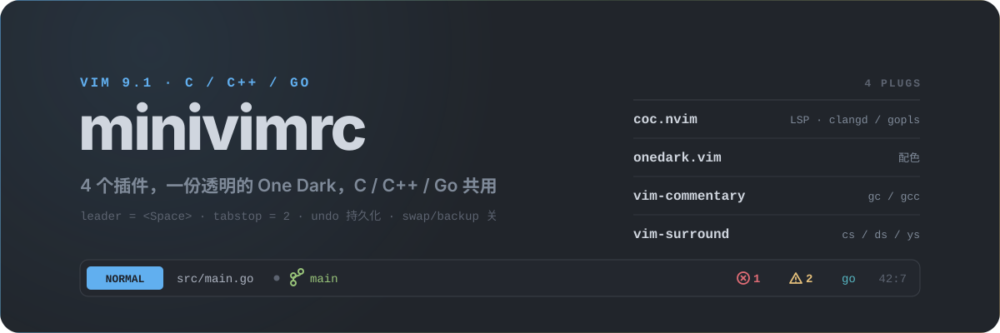

# minivimrc



**一份给 C / C++ / Go 用的 Vim 9.1 配置：只装 4 个插件，coc 负责补全和诊断，配色是透明的 One Dark，状态栏自己写。**

整个配置就是 `.vimrc` 一个文件、346 行。没有插件清单、没有安装脚本、没有框架，改什么都能一眼在文件里找到。目标是让 Vim 在补全、跳转、诊断这几件事上够用，而不牺牲启动速度和透明背景。

## 它长什么样

状态栏是这份配置里最显眼的自定义件，从左到右就是一次编辑时你真正需要的信息：

```text
 NORMAL   src/main.go ●   main    ✘ 1  ▲ 2   go   42:7
```

图标用的是 Nerd Font 的 mdi / octicon 码位（`nr2char(0xF0159)` 这类）。终端没装 Nerd Font 时这几处会显示成方块，其余一切正常。

从左到右依次是：模式块、相对路径、未保存标记、git 分支、错误与警告数、文件类型、光标行列。

- 模式块按模式换底色：NORMAL 蓝、INSERT 绿、VISUAL 紫、REPLACE 红、COMMAND 黄、TERMINAL 青。
- 分支名按 buffer 缓存，`BufEnter` / `DirChanged` 时刷新，不每次重绘都去跑 `git`。
- 诊断数字直接读 coc 的 `b:coc_diagnostic_info`，为 0 时整段不占位。
- 主窗口 `guibg=NONE`，背景交给终端（配置注释里记的是 Ghostty，`background-opacity = 0.8`）；只有补全弹窗和浮窗是实心卡片，免得和背后的代码糊在一起。

## 快速开始

依赖：

| 依赖 | 说明 |
| --- | --- |
| Vim 9.x | 需要 `+clipboard` `+timers` `+popupwin` `+textprop` `+persistent_undo`（`vim --version \| grep clipboard` 自查） |
| Node.js | coc.nvim 的运行时 |
| clangd | C / C++ 补全，来自 `brew install llvm` |
| gopls、goimports | Go 补全与整理 import，来自 `go install` |

```bash
# 1. 装 vim-plug
curl -fLo ~/.vim/autoload/plug.vim --create-dirs \
  https://raw.githubusercontent.com/junegunn/vim-plug/master/plug.vim

# 2. 放配置，并建好 undo 目录（undofile 依赖它，缺了会报错）
mkdir -p ~/.vim/undo
cp .vimrc ~/.vimrc

# 3. 装 4 个插件；首次启动 coc 会自己再装 4 个扩展
vim +PlugInstall +qall
```

`go install` 装出来的二进制落在 `~/go/bin`，配置里已经把这条路加进 `$PATH`，不用再手改：

```bash
go install golang.org/x/tools/gopls@latest
go install golang.org/x/tools/cmd/goimports@latest
```

clangd 若不在 `$PATH`（Homebrew 的 `llvm` 是 keg-only），把 `/opt/homebrew/opt/llvm/bin` 加进 PATH，或者在 `:CocConfig` 里指定 `clangd.path`。本仓库**没有**附带 `coc-settings.json`，clangd / gopls 的参数需要你自己在 `:CocConfig` 里补。

> 启动后如果插入模式回车报 `E117: Unknown function: autopair#cr`，看下面的[本地插件](#本地插件不在仓库里)一节——这是缺文件，不是配置写错。

## 快捷键

`<Space>` 是 leader，`,` 是 localleader。

**日常**

| 键 | 作用 |
| --- | --- |
| `<Space>w` / `<Space>q` | 保存 / 退出 |
| `<Space>h` 或 `<Esc>` | 清除搜索高亮 |
| `<C-h>` `<C-j>` `<C-k>` `<C-l>` | 在分屏之间移动 |
| `gc` / `gcc` | 注释选区 / 当前行（vim-commentary） |
| `cs` `ds` `ys` | 改 / 删 / 加包围符（vim-surround） |

**跳转与重构**

| 键 | 作用 |
| --- | --- |
| `gd` / `gD` | 跳定义 / 跳声明 |
| `gi` / `gy` | 跳实现 / 跳类型定义 |
| `gr` | 查引用 |
| `K` | hover 文档 |
| `<Space>rn` | 重命名 |
| `<Space>ca` / `<Space>cl` | code action（光标处 / 整行，可视模式下作用于选区） |
| `<Space>f` | 格式化（可视模式只格式化选区） |
| `<Space>qf` | 修当前行的诊断 |
| `<Space>oi` | 整理 import（只对 Go 生效；C / C++ 走 `<Space>ca`） |
| `[g` / `]g` | 上一条 / 下一条诊断 |
| `<Space>d` / `<Space>o` | 诊断列表 / 大纲 |
| `<Space>cb` / `<Space>cB` | 静音当前 buffer 的诊断 / 全局开关诊断 |
| `<Space>cR` | 重启 coc（clangd 卡住或换参数后） |

**补全**

| 键 | 作用 |
| --- | --- |
| `Tab` / `S-Tab` | 候选列表里上下选；不在列表里时 `Tab` 触发补全（行首或前一个字符是空白时，仍然插入缩进） |
| `<C-Space>` | 手动触发补全 |
| `<CR>` | 确认候选；空 `{}` 中回车展开成三行（这一条来自下面的 autopair） |

## 几个刻意的取舍

- **没有 swap 和 backup，但有 undo 持久化。** 崩溃后靠 `~/.vim/undo` 里的 undo 文件恢复，磁盘上不留 `.swp`。
- **`signcolumn=yes` 常驻。** 诊断出现时不会多占一列，整屏不跳。
- **`cursorlineopt=number`。** 只高亮行号，不铺整行底色——透明背景下整行压暗很难看。
- **缩进跟 Neovim 习惯对齐。** 全局 `ts=2 sw=2`、空格缩进；Go 单独切回 Tab（gofmt 要求）；C / C++ 2 空格；Python 交给 Vim 自带的 `ftplugin/python.vim`，仍是 4 空格。
- **大文件自动降级。** 超过 5 MB 关掉相对行号和 undofile，避免打开日志时卡住。
- **临时文件不挂诊断。** `/tmp` 下打开的文件自动设 `b:coc_diagnostic_disable`，写一次性试验头文件时不至于满屏红线；其它文件用 `<Space>cb` 单独静音。
- **只用 4 个插件。** LSP、补全、诊断全交给 coc，注释和括号交给两个 tpope 插件，其余都用原生 Vim。

## 状态栏怎么拼的

| 段 | 内容 | 来源 |
| --- | --- | --- |
| 模式块 | NORMAL / INSERT / VISUAL / V-LINE / V-BLOCK / REPLACE / COMMAND / TERMINAL | `SLMode()`，按 `mode(1)` 换高亮组 |
| 路径 | 相对当前目录的路径，未命名时显示 `[No Name]` | `fnamemodify(expand('%'), ':~:.')` |
| `●` | 有未保存修改时出现 | `&modified` |
| 分支 | git 当前分支，缓存在 `b:git_branch` | `git rev-parse --abbrev-ref HEAD` |
| 诊断 | 错误数 / 警告数，为 0 时不显示 | `b:coc_diagnostic_info` |
| 类型 | `&filetype` | 来自 Vim |
| 行列 | `42:7` | `line('.')` / `col('.')` |

配色全部来自 `UiTweaks()`：`#61afef` 蓝、`#98c379` 绿、`#e5c07b` 黄、`#e06c75` 红、`#56b6c2` 青、`#c678dd` 紫，正文 `#d0d6df`，注释 `#7f8a99`。

## 可调项

配置里用到的 `g:` 变量都在 `.vimrc` 里直接声明，没有另外的配置文件，改完重开即生效。

| 变量 | 默认 | 作用 |
| --- | --- | --- |
| `g:flashop_duration` | `180` | 操作后闪烁时长（ms） |
| `g:flashop_echo_delete` | `1` | 删除 / 修改时在右下角提示删掉的内容 |
| `g:flashop_toast_ms` | `900` | toast 停留时长（ms） |
| `g:flashop_max_lines` | `80` | 超过这个行数就不闪，防卡顿 |
| `g:flashop_min_chars` | `2` | 内容太短不提示（`x` 删单字符不吭声） |
| `g:autopair_enabled` | `1` | 自动配对总开关 |
| `g:autopair_expand_cr` | `1` | 空 `{}` 里回车展开成三行 |
| `g:autopair_cr_pairs` | `'{}'` | 哪些括号对参与展开 |
| `g:autopair_smart_quotes` | `1` | 注释、字符串、词尾处不配对引号 |
| `g:onedark_termtrans` | `1` | 把配色背景设为透明 |
| `g:markdown_recommended_style` | `0` | 让 Markdown 跟随全局 2 空格 |
| `g:coc_global_extensions` | `coc-clangd` `coc-go` `coc-snippets` `coc-json` | 首次启动自动安装的 coc 扩展 |

## 本地插件（不在仓库里）

这份 `.vimrc` 引用了两个自写插件，文件在 `~/.vim` 下，**没有一起提交**：

```text
~/.vimrc                      ← 本仓库唯一的文件
~/.vim/undo/                  ← undofile 目录，需要自己 mkdir
~/.vim/plugged/               ← vim-plug 装的 4 个插件
~/.vim/plugin/flashop.vim     ← 操作后闪一下被作用的文本（y / d / > 等）
~/.vim/plugin/autopair.vim    ← 自动配对括号引号的映射
~/.vim/autoload/autopair.vim  ← 自动配对的实现
```

缺这两个插件时的行为：

- `flashop`：只是 `<Space>tf` 会报 `E492`，其余不受影响。
- `autopair`：**会影响打字**——`inoremap <CR> autopair#cr()` 覆盖了上一行 coc 的 `<CR>`，函数不存在时每次回车都报 `E117`。

所以只拿 `.vimrc` 不拿插件时，把这一行删掉，让上面那条 coc 的 `<CR>` 生效：

```vim
" 删掉或注释掉这一行（没有 autopair 插件时）
inoremap <silent><expr> <CR> autopair#cr()
```

同时可以把 `<Space>tf` / `<Space>tp` 两条映射一并注掉，键位保持干净。

## 已知限制

- **偏 macOS。** `path` 里写死了 `/opt/homebrew/include` 和 `/usr/local/include`，`$PATH` 里加了 `~/go/bin`。
- **透明背景需要终端配合。** 配置把 `guibg` 全设成 `NONE`，普通不透明终端上看到的就是纯 One Dark 底色，不影响观感，但"透明"效果没有。
- **状态栏依赖 Nerd Font。** 见上文。
- **没有 `coc-settings.json`。** clangd 的编译参数、gopls 的 `buildFlags` 之类的项目级设置需要自己在 `:CocConfig` 里写。
- **Rust、TypeScript、Python 的 LSP 没配。** `coc_global_extensions` 只装了 C/C++、Go、snippets、JSON 四个。

## 接下来

仓库现在缺的东西，按需要补：

- 把 `flashop.vim` / `autopair.vim` 一并提交，或者把 `<CR>` 那条映射改成可选加载，让 `.vimrc` 单独就能用。
- 补一份 `coc-settings.json` 模板（clangd 编译参数、gopls `buildFlags`）。
- 加 LICENSE。

## License

仓库里没有 LICENSE 文件，默认保留所有权利。想复用其中某段配置，开个 issue 说一声即可。

---

参考：[Vim 文档](https://vimhelp.org/)、[coc.nvim](https://github.com/neoclide/coc.nvim)、[vim-plug](https://github.com/junegunn/vim-plug)。